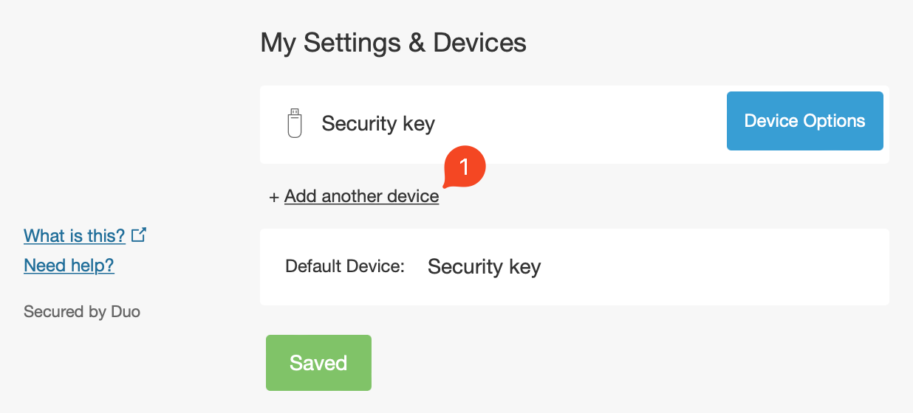
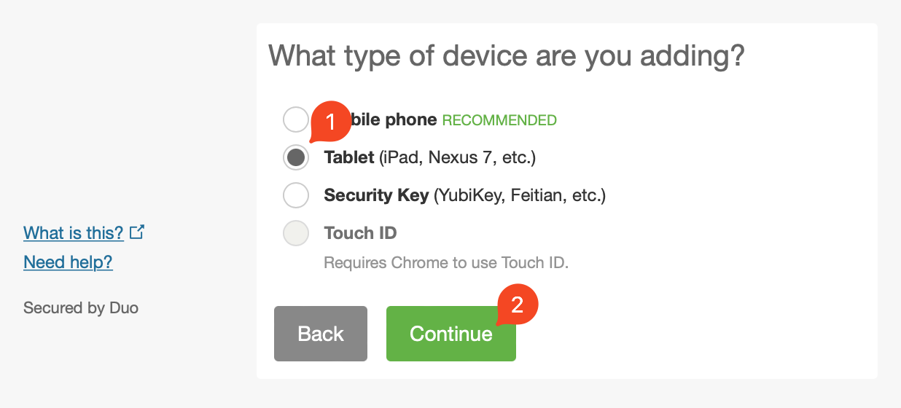
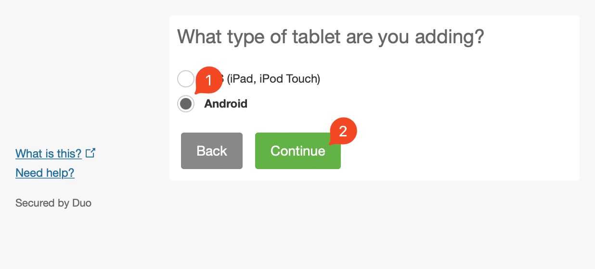
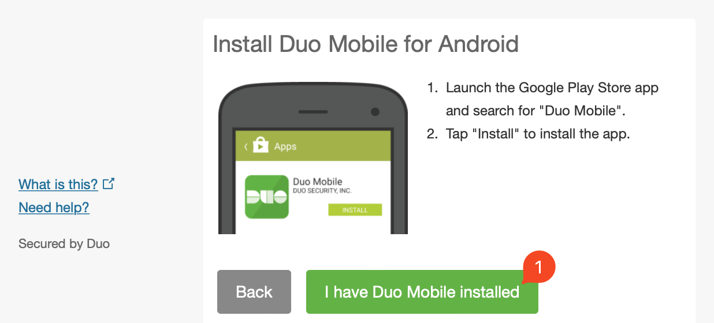
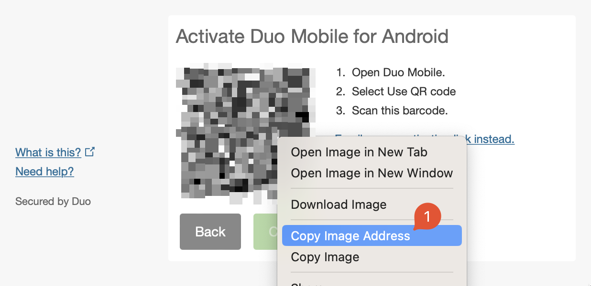

**One HTML file with integrity-checked CDN dependencies** — [choose your university at unduo.me](https://unduo.me) to download yours.

# unduo

**Un-Duo yourself by making it possible to use any 2FA application for Duo
Security authentication.**

`unduo` lets you use any standard two-factor authentication app in place of
Cisco's proprietary Duo Mobile software. It registers a virtual device with Duo
and hands you a QR code (and `otpauth://` URI) you can add to Google
Authenticator, 2FAS, Aegis, or any other authenticator app that supports
counter-based (HOTP) codes. Download your university's file from the website, or
run the same steps yourself [in a terminal](#in-a-terminal).

## Website

Go to **[unduo.me](https://unduo.me)** and follow its steps: select your university,
download its file, `UnDuo - <school name>.html`, without running it, then drag it into your
favorite AI with the prompt the page gives you. Once the AI gives the thumbs up, double
click the file for a five-step guided setup with its own stepper. Setup runs only from
that file, never on the website: students shouldn't get used to doing something
this sensitive through a website, so the site serves the file as a download and
has no page that runs it.

1. **Open your Duo device portal.** Sign in where you manage your Duo devices.
   Your university's file links to its verified enrollment portal if it has one,
   and shows what Duo's prompt looks like once you're signed in.
2. **Authenticate with Duo.** Use a passcode or a push as you normally would,
   until you land on Duo's _My Settings & Devices_ page.
3. **Copy the activation QR code.** In the portal, add a device
   (Tablet → Android → _I have Duo Mobile installed_), right-click the QR code,
   choose **Copy Image**, and press <kbd>⌘V</kbd>/<kbd>Ctrl+V</kbd> anywhere on
   the page. A copied image address, an emailed activation link, a dropped or
   uploaded screenshot, or **Scan my screen** work too.
4. **Activate with Duo.** Your browser submits the activation directly to Duo,
   and its reply shows in a box on the page. Select all, copy, and paste it into
   the field under the box. Duo's reply holds your new key, so clear your clipboard
   after pasting if it syncs to other devices. Each QR code works once; if Duo says the code expired or was used, unduo tells you
   to make a new one.
5. **Add it to your authenticator.** Scan the QR code with an app that supports
   counter-based codes (Google Authenticator, 2FAS, Aegis, FreeOTP), then test a
   passcode on any Duo sign-in. Switch to **Time-based** only if your
   organization uses time-based Duo passcodes.

The current site publishes [University of Toronto](https://unduo.me/?university=IAU-020599),
the institution confirmed supported so far, [University of Waterloo](https://unduo.me/?university=IAU-020623),
whose file follows Duo's Universal Prompt from Waterloo's own instructions,
[Western University](https://unduo.me/?university=IAU-020629) (the University of Western Ontario), whose
file goes through Western Identity Manager, and
[Other](https://unduo.me/?university=other), a file
for any other school or company that names no institution and links to no portal. The home picker and generated files
use the same scope. Full-directory builds remain available through
`UNDUO_UNIVERSITIES=all`.
The canonical directory comes from the complete [WHED catalog snapshot](https://mix-n-match.toolforge.org/#/catalog/7299), enriched with domain aliases and 32 documented Duo portal URLs. Directory inclusion does not confirm Duo use.
See [directory coverage and maintenance](packages/me/unduo/data/universities/README.md).

The website is a set of static pages, built with Vite and styled with UIkit's CSS and Tailwind CSS. **There is
no activation backend: activation codes and authenticator secrets never pass
through an unduo server.** The browser generates the request's public key,
submits a native form directly to a validated `api-*.duosecurity.com` host, and
parses the pasted reply locally. Copying the reply by hand is necessary because
Duo's API sends no CORS headers, so no web page can read Duo's response.

Pasted images, uploads and shared screens are decoded locally and never uploaded
or recorded. Screen sharing requests video only and stops on detection, Stop
Sharing, page exit, errors, or a five-minute timeout. The activation code,
Duo's reply and your key stay in the tab's memory. They are never written to the
URL, browser history or browser storage, so refreshing or closing the tab clears
them, and the browser asks before you leave with progress. The URL hash records
only the step and code type. There are no accounts, analytics or cookies.

The home page saves it as `UnDuo - <school name>.html` to open
directly in your browser. The file is small enough to paste into an AI assistant and ask
whether it is safe to run. All the JavaScript it runs is in the file, inline and
readable: unduo's own code and [VanJS](https://vanjs.org), a small library that builds the page's elements. The setup logic runs in a WebAssembly
plugin compiled from [`crates/setup`](crates/setup), loaded with no access to the
page, the network or storage, so it can only return values. One guard in the page's
inline code stops the page unless those values match an exact schema, including
strict rules for the URL hash, the Duo form and the authenticator link: the Duo
URL must come from what you pasted, and the authenticator link from Duo's reply.
A second instance of the plugin reads pasted and shared QR codes, and the page's own
code draws the authenticator QR code from the guarded link. Each jsDelivr tag's `data-integrity-source` and
`data-integrity-file` attributes, described by its `data-comment`,
name the file's SHA-256 in jsDelivr's public
API, so an auditor can check the file against a source other than unduo (see
[Verifying CDN files](#verifying-cdn-files)).
The stylesheet, help images and plugin load from a content-addressed jsDelivr
commit, with SRI for the stylesheet and SHA-256 for the plugin. The CSP limits
fetches to that plugin file and forms to Duo. The CSP `<meta>` and the plugin's
root element each carry a `data-comment` that describes them.
`vp run check:plugin` rebuilds the
plugin from source and checks it is byte-for-byte the published one. An
internet connection is required to load these files.

Adding devices and passcode sign-ins must be allowed by your organization. Keep
an existing sign-in method until a code from your new authenticator works.

## Is it secure?

Yes. Duo uses the same OTP standards as every other 2FA app in the security
space — they just wrap that standard in their own software to lock you into
their app. This tool tells Duo that you are the Duo app, allowing you to
activate a 2FA key in whatever app you choose.

## Why not just use Duo?

There are many reasons you might want to avoid the Duo app, from usability to
ideology:

- You already use a 2FA app like Google Authenticator and don't want another.
- You prefer open-source or non-proprietary software.
- You are uncomfortable with the data collection in the Duo Mobile app.
- You would like Duo 2FA access on a computer, not just a mobile device that
  may die.
- You have multiple devices you would like to secure with a single 2FA
  solution.
- You would like 2FA autofill so you never have to deal with Duo notifications
  or codes.

## In a terminal

Three commands do what the website does, with `curl`, `openssl` and `python3`
in place of unduo's code: everything they do is in the lines below. Linux
includes them, as does macOS once Xcode's command line tools are installed. The
website shows the same commands under **Terminal**.

1. Navigate to your organization's Duo Security portal.
2. Log in with your current Duo 2FA method.
3. In the Security Portal, select **+ Add another device**.

   

4. Select **Tablet**, then **Continue**.

   

5. Select **Android**, then **Continue**.

   

6. Select **I have Duo Mobile installed**.

   

7. Right-click the QR code and select **Copy Image Address**. It looks like
   `https://api-XXXXXXXX.duosecurity.com/frame/qr?value=…`.

   

Set `host` to that address's `api-…` host, and `code` to the letters and digits
after the last `value=`, `duo%3A%2F%2F` or `activate%2F`, up to any `-` or `&`.
In `…value=duo%3A%2F%2FABCDE12345-YXBp…`, that's `ABCDE12345`. An activation
link from a Duo email, `https://m-XXXXXXXX.duosecurity.com/activate/CODE`, works
too: its host is `api-XXXXXXXX.duosecurity.com`.

```sh
host=api-XXXXXXXX.duosecurity.com
code=ABCDE12345
```

Register a new Duo Mobile device. `openssl` makes a key pair and keeps only its
public key, and `curl` posts it to Duo with the same device details as the
website's form. Duo's reply stays in the shell's `reply` variable. Run this once:
each code works once.

```sh
pubkey=$(openssl genrsa 2048 | openssl rsa -pubout)
reply=$(curl -sS "https://$host/push/v2/activation/$code?customer_protocol=1" -A okhttp/2.7.5 \
  --data-urlencode "pubkey=$pubkey" -d pkpush=rsa-sha512 \
  -d platform=Android -d version=13 -d manufacturer=Google -d model=Cheetah \
  -d app_id=com.duosecurity.duomobile -d app_version=4.33.0 -d app_build_number=433000 \
  -d architecture=arm64 -d jailbroken=false -d full_disk_encryption=true -d passcode_status=true \
  -d security_patch_level=2024-01-01 -d region=US -d language=en)
```

Print the key and its `otpauth://` link. Python reads Duo's reply locally,
base32-encodes its `hotp_secret` and formats the link.

```sh
printf %s "$reply" | python3 -c '
import base64, json, sys, urllib.parse
reply = json.load(sys.stdin)
if reply.get("stat") != "OK": sys.exit("Duo said: %s" % reply.get("message"))
key = base64.b32encode(reply["response"]["hotp_secret"].encode()).decode().rstrip("=")
name = urllib.parse.quote(reply["response"]["customer_name"], safe="")
print("Key:", key)
print(f"otpauth://hotp/Duo:{name}?secret={key}&issuer=Duo&algorithm=SHA1&digits=6&counter=0")'
```

Add the key to an authenticator app that supports counter-based (HOTP) codes,
such as Google Authenticator, 2FAS, Aegis or FreeOTP, or show the link as a QR
code to scan with [qrencode](https://fukuchi.org/works/qrencode/):
`qrencode -t ansiutf8 'otpauth://…'`. If it prints `Duo said: …` instead, get a
new QR code and start again. Close the terminal when you're done, since `reply`
holds your key. You can rename the device in Duo if you like.

If your organization switched Duo to time-based passcodes and the codes are
rejected, change `hotp` to `totp` and `counter=0` to `period=30` in the link, or
add the key as a time-based account. Test a passcode on a Duo sign-in before
removing any other method.

To generate passcodes in a terminal instead of an app, use
[oath-toolkit](https://www.nongnu.org/oath-toolkit/)'s `oathtool`. Duo accepts
each counter value once, so add one to the counter after every code:

```sh
oathtool --hotp --base32 --counter=0 KEY
```

For time-based organizations, run `oathtool --totp --base32 KEY`.

## Notes

- Duo validates this device's passcodes as **HOTP** (counter-based, RFC 4226,
  SHA-1, 6 digits, counter starting at 0). Use an authenticator that supports
  counter-based codes. Organizations that switched Duo to time-based passcodes
  accept TOTP codes from the same key instead (**Time-based** on the website,
  or a `totp` link in the terminal).
- Duo's activation API responds without CORS headers, which is why the website
  asks you to copy Duo's reply back by hand. The terminal commands read it
  directly.

## Credits

`unduo` stands on the shoulders of prior work:

- [kop316/duo-cli](https://gitlab.com/kop316/duo-cli) — the Python CLI whose
  activate / generate / export flow this project follows.
- [nilsstreedain/duo-bypass](https://github.com/nilsstreedain/duo-bypass) —
  whose setup guide is adapted above.
- [revalo/duo-bypass](https://github.com/revalo/duo-bypass) — the original
  reverse-engineering of the Duo activation flow.

## Development

The web app's pages are built with [Vite](https://vite.dev), and [VanJS](https://vanjs.org) builds everything they show in the browser.
Workspace commands, checks and tests use
[Vite+](https://viteplus.dev) (`vp`) and [bun](https://bun.sh).
Web development requires Node.js 22.18 or newer, which runs the build's TypeScript directly.

```bash
vp install             # install dependencies
vp run dev             # mprocs: Vite on 3000
vp run dev:web         # Vite alone, without the mprocs TUI
vp run build:web       # home page and UofT's file
vp check               # format, lint and type-check
vp test                # run the unit tests (Duo calls are mocked)
```

### Deploy the website

The default build publishes only the home page, the University of Toronto file
at `/files/020599`, the University of Waterloo file at `/files/020623`, the
Western file at `/files/020629` and the generic file at `/files/other`. `UNDUO_UNIVERSITIES=published` is
the default; use `UNDUO_UNIVERSITIES=all vp run build:web` to generate the full
directory. The flag also controls development routes and the picker, so it never
links to omitted institutions. Unknown flag values fail the build.

The optional full-directory build shares application scripts and CDN dependencies
across institution files. Keep the default UofT scope for the current Pages
deployment.

```bash
vp run build:web
vp run preview         # serve www/ at http://127.0.0.1:3000
```

GitHub Pages Actions builds and publishes `www/` at [unduo.me](https://unduo.me).
In **Settings → Pages**, select **GitHub Actions** as the source. The build copies
`.nojekyll` and `CNAME` into `www/`. Cloudflare is used only for DNS; see
[GitHub's custom-domain instructions](https://docs.github.com/en/pages/configuring-a-custom-domain-for-your-github-pages-site/managing-a-custom-domain-for-your-github-pages-site).

Commit source changes and push to `main` to publish. Generated HTML is kept in `www/` for inspection and downloads. The home page contains the university picker; each selected institution
has its own file, `www/files/<WHED-number>`, and **Other** has `www/files/other`, with no extension so that
GitHub Pages serves it as a download and never runs it. Each document embeds its application script inline;
`www/cdn/` holds only the setup files' Tailwind stylesheet, help images and setup plugin, and `www/cdn-home/`
the home page's stylesheet and images, never JavaScript. They are separate commits, so a change to the home page never
changes a setup file or its SHA-256.

A file opens directly via `file://`. It loads its stylesheets,
help images and setup plugin from integrity-checked jsDelivr files, so it needs
internet for those and to contact Duo.

The HTML meta CSP allows only the page's hashed inline scripts, limits fetches to
the plugin and screenshot files, allows images only as `data:` and `blob:` URLs so
stylesheets can request nothing, and restricts form submissions
to Duo's HTTPS domain. Activation host validation
further restricts requests to `api-*.duosecurity.com`. Pasted replies are bounded
and validated; raw replies and parser errors containing credentials are never
logged or displayed. There are no automatic activation retries. Automated tests
use synthetic Duo replies; a real successful enrollment requires a
user-controlled QR code and is not part of automated tests.

Everything a page shows is built in the browser with
[VanJS](https://vanjs.org), the one third-party script, whose readable source is inlined in the page.
Adjacent TypeScript handles activation, QR processing and progress. UIkit's CSS loads from jsDelivr; no UIkit JavaScript runs. Every CDN
resource has a SHA-256 integrity attribute. Tailwind CSS compiles locally into unduo's own
stylesheet, which the home page and every file load from jsDelivr with SRI.

### Verifying CDN files

Every `cdn.jsdelivr.net/npm` tag names an independent record of its file. The
browser enforces the tag's SHA-256 `integrity`, so it is enough to check that
jsDelivr lists the same hash for that file. For example:

```sh
api='https://data.jsdelivr.com/v1/packages/npm/uikit@3.25.29?structure=flat' # data-integrity-source
file=/dist/css/uikit.min.css # data-integrity-file

# Must print the tag's integrity value exactly.
curl -fsSL "$api" | jq -er --arg f "$file" '.files[] | select(.name == $f) | "sha256-" + .hash'
```

unduo's own stylesheet and setup plugin name jsDelivr's listing of their GitHub
commit the same way. The stylesheet's `integrity` is checked like UIkit's.
The plugin root's `data-plugin-integrity`, which the page's `fetch` enforces,
is checked the same way:

```sh
curl -fsSL "$api" | jq -er --arg f "$file" '.files[] | select(.name == $f) | "sha256-" + .hash'
# must print data-plugin-integrity
```

A match shows the bytes are the published release, not that the release is free
of vulnerabilities. Because jsDelivr serves both answers, `vp run verify:cdn` also
downloads each package from the npm registry, checks the tarball's SHA-512 and
compares the file, and compares unduo's own files with GitHub's copy of the commit. Builds check each SRI hash against the installed npm package,
which Bun verifies against the lockfile.

### Build provenance

The Deploy workflow attests every file in `www/files/`, `www/cdn/`
(the setup files' stylesheet, help images and `setup.*.wasm`) and `www/cdn-home/` with
[GitHub artifact attestations](https://docs.github.com/en/actions/security-for-github-actions/using-artifact-attestations).
Each attestation is signed through Sigstore and names the commit and workflow
run that built the file's SHA-256:

```sh
gh attestation verify "UnDuo - University of Toronto.html" --repo UnDuoMe/unduo.me  # the downloaded file
gh attestation verify setup.*.wasm --repo UnDuoMe/unduo.me                   # the file at data-plugin-url
```

To rebuild the plugin from that commit, check it out and run
`vp run check:plugin`, which compiles `crates/setup` with the pinned toolchain
and fails unless the result equals the committed `setup.wasm` byte for byte.
The Check workflow runs the same comparison on Linux for every push.

Build checks reject unreviewed script URLs, mismatched integrity metadata,
unpinned module imports and unreviewed CSS resource loads. Update dependencies
through the root Bun catalog, then run `vp run update:cdn` and review the URLs and
hashes in `apps/unduo-web/src/cdn-resources.html`. Normal builds use those
reviewed pins without fetching code or updating hashes.

See [DEVELOPMENT.md](./DEVELOPMENT.md) for the Flatcap workspace layout,
reverse-DNS package names, import boundaries, and development commands.

## Disclaimer

This tool is intended for legitimate use with accounts you control (for
example, to use an open source authenticator instead of Duo Mobile). Do not use
it against accounts you are not authorized to access.

## License

[MIT](./LICENSE)
